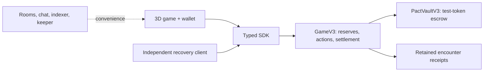

**Play online:** [DUSTPACT](https://dimik98330.github.io/DUSTPACT/) — free 3D learning expedition, without a wallet. Multiplayer, onchain pacts and token escrow require the separate Solana/services setup described below.

<p align="center">
  
</p>

<p align="center">
  <strong>A 3D social strategy game where a pact turns a promise into a verifiable commitment.</strong>
</p>

<p align="center">
  <a href="README.md"><strong>English</strong></a> · <a href="README.ru.md">Русский</a><br>
  <a href="#play-in-two-commands">Play locally</a> · <a href="#why-solana">Why Solana</a> · <a href="docs/DEVELOPMENT.md">Run the full stack</a> · <a href="docs/ARCHITECTURE.md">Architecture</a>
</p>

<p align="center">
  
  
  
  
</p>

---

## One caravan. Different interests.

Players start with different water/tool supplies, **but nobody has cargo**. Four to six travelers must reach a city together. Along the way, you restore a well, negotiate bridge repairs, invest in salvage and protect what you earn.

Everyone needs the caravan to arrive. Everyone also wants their own score.

You can cooperate on trust. Or accept a **pact** that reserves the exact supplies, binds the provider's action and fixes how the result is shared. Your partner can disconnect; an accepted obligation still follows the program's rules.

<p align="center">
  
  <sub>Actual game UI. The wallet-free learning mode resolves the same Rust/Wasm rules offchain.</sub>
</p>

## Play in two commands

**Requires Node.js 22.12+ and npm.** Browser engine assets are included; no wallet, Rust toolchain, database or SOL is needed for the learning mode.

```bash
git clone https://github.com/dimik98330/DUSTPACT.git
cd DUSTPACT
npm ci
npm run demo
```

Open **[the learning expedition](http://127.0.0.1:4173/?version=3&mode=practice&tutorial=0&lang=en)**. Choose your move, negotiate with three labeled game agents and complete six encounters.

| Mode                | What runs                                                                 | What you need                                                   |
| :------------------ | :------------------------------------------------------------------------ | :-------------------------------------------------------------- |
| **Learning**        | Real 3D game + local Rust/Wasm rules                                      | Node.js; no wallet                                              |
| **Solana Localnet** | Native game program, token vault, wallet/session flow, rooms and recovery | Solana tools + local services; see [setup](docs/DEVELOPMENT.md) |

> Learning is explicitly **offchain**. It does not submit Solana transactions or pay tokens. Localnet uses valueless simulated test tokens, not Circle-issued USDC.

## Six encounters, six different decisions

| Encounter                | The decision                                        | Why negotiate?                                                      |
| :----------------------- | :-------------------------------------------------- | :------------------------------------------------------------------ |
| **Ruined well**          | Fund water production or take the dry route         | Your supplies and a partner's tool/action complete the recipe       |
| **Broken bridge**        | Repair together or spend water on a detour          | Buy a specific repair contribution; the route affects later salvage |
| **Abandoned storehouse** | Invest scarce inputs in limited extraction          | Agree on who works and who receives the cargo                       |
| **Ambush**               | Protect shared cargo or pursue personal preparation | Secure another player's guard action                                |
| **Dust storm**           | Prepare shelter and replenish supplies              | Earlier losses change which contribution matters most               |
| **City behind the fog**  | **Deliver, Guard or Market** — choose one           | A delivery pledge binds already-owned cargo and the delivery action |

One action and one pact seal per player per encounter. A pact guarantees a formal contribution, **not the caravan's victory**. Unbound choices remain hidden until reveal.

Personal score: **3 × remaining cargo + delivered cargo + contribution**. Arrival and a non-forfeited personal record are required to keep that score.

## Why Solana?

The chain is where commitments become enforceable game rules.

| Onchain responsibility         | What the player gets                                                                    |
| :----------------------------- | :-------------------------------------------------------------------------------------- |
| **Exact consent**              | A signature approves concrete terms, not an open-ended promise                          |
| **Reservations**               | Accepted supplies cannot also fund another action                                       |
| **Bound work and delivery**    | An accepted obligation survives a missing reveal under the rules                        |
| **Canonical settlement**       | The program resolves supplies, delivery and the retained result                         |
| **Independent recovery**       | Another client can finish execution directly through RPC without our application server |
| **Separate test-token escrow** | A completed paid job has a fixed recipient and cannot be paid twice                     |

**Pacts:** instant barter, work orders, joint production and city delivery pledges. Camera movement, animation, chat and backend projections do not decide the outcome.

Recovery still needs a reachable Solana RPC. Revealing your own commitment requires the original saved move; the recovery client cannot reconstruct an unknown hidden choice.

<p align="center">
  
</p>

### Optional mission: two paid bridge repairs

A sponsor separately deposits **20 test tokens**. Two repair jobs pay **10 each**. Entry is free; players do not wager money. The recipient is the provider's seat owner, and performed work keeps its payout right even if the caravan later fails.

Unfilled slots can refund after their deadline. Accepted slots wait for the program's result. Demonstration agents cannot take paid jobs. A bounded game session cannot debit the owner's wallet tokens.

## Built to be inspectable



| Layer                   | Source                                                                                     |
| :---------------------- | :----------------------------------------------------------------------------------------- |
| Game and 3D world       | [`apps/web`](apps/web)                                                                     |
| Independent recovery    | [`apps/recovery`](apps/recovery)                                                           |
| Shared Rust/Wasm rules  | [`crates/rules-v3`](crates/rules-v3), [`crates/rules-v2`](crates/rules-v2)                 |
| Native game and vault   | [`programs/game-v3`](programs/game-v3), [`programs/pact-vault-v3`](programs/pact-vault-v3) |
| Transactions and replay | [`packages/solana-v3`](packages/solana-v3), [`packages/engine`](packages/engine)           |
| Supporting services     | [`services/backend`](services/backend)                                                     |

Protocol 3 is the current game. Protocol 2 modules remain explicit compatibility dependencies; accounts are not silently migrated.

## Run the checks

```bash
npm run typecheck
npm run backend:typecheck
npm test
npm run build
```

Rebuild the browser rules from Rust with `npm run build:wasm`. Native program builds and service setup are documented in [DEVELOPMENT.md](docs/DEVELOPMENT.md).

## What is verified — and what is next

**Local evidence:** native programs and shared rules tested; a six-encounter campaign completed through the SDK; an accepted delivery executed despite the provider missing reveal; independent recovery completed settlement while application services were stopped. A separate local escrow scenario paid 10 test tokens, refunded the other 10 and rejected duplicate effects. These use generated test actors, not external wallets or human playtests.

**Still to validate:** two external Wallet Standard wallets, uninterrupted multiplayer browser acceptance, human comprehension/retention and a reviewed public deployment. This repository is a local-first hackathon MVP; no public mainnet/devnet deployment or immutable public-program claim is made.

<details>
<summary><strong>More of the product</strong></summary>


</details>

---

**Source rights.** Publicly readable source; no project-wide open-source license is granted. Third-party assets retain their original licenses. See [asset credits](docs/ASSETS.md).
