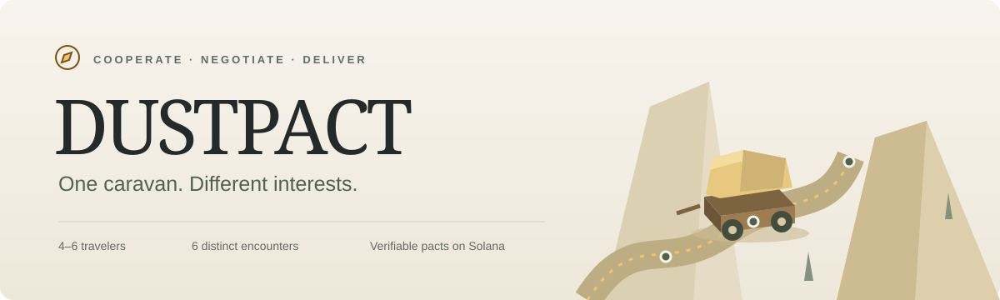
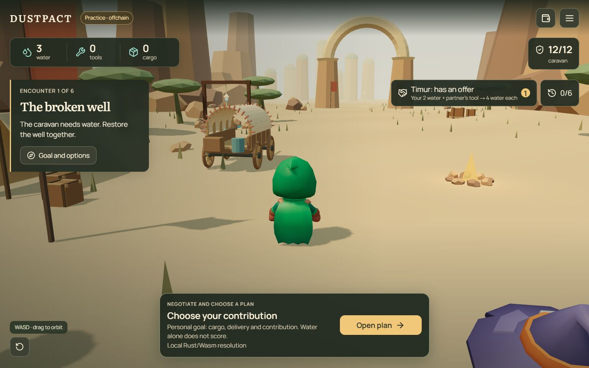
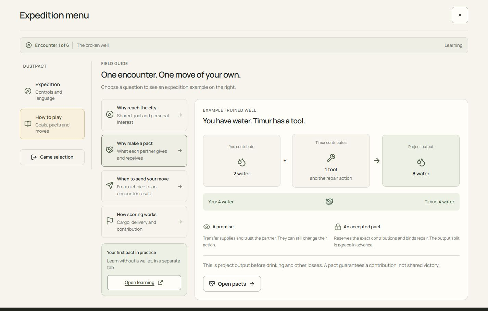
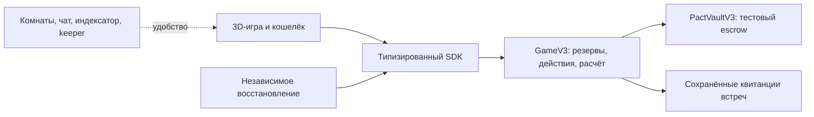
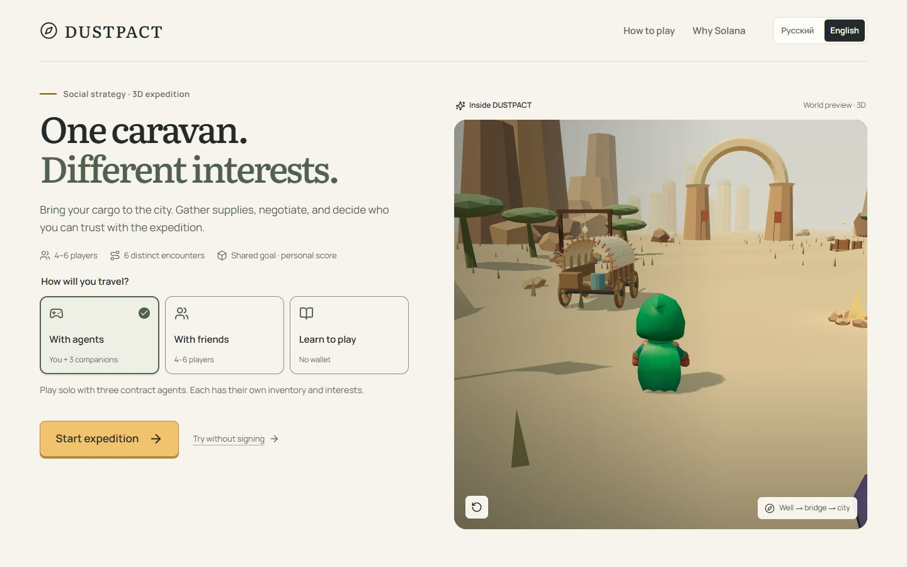
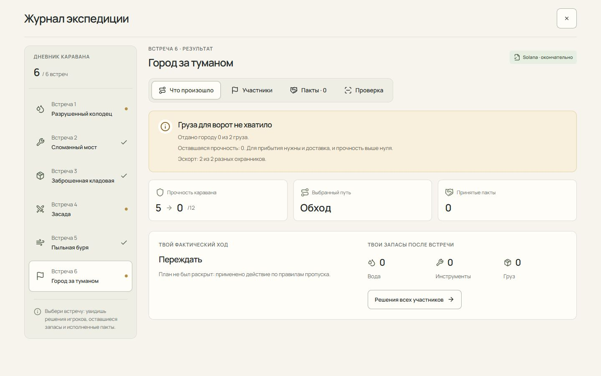
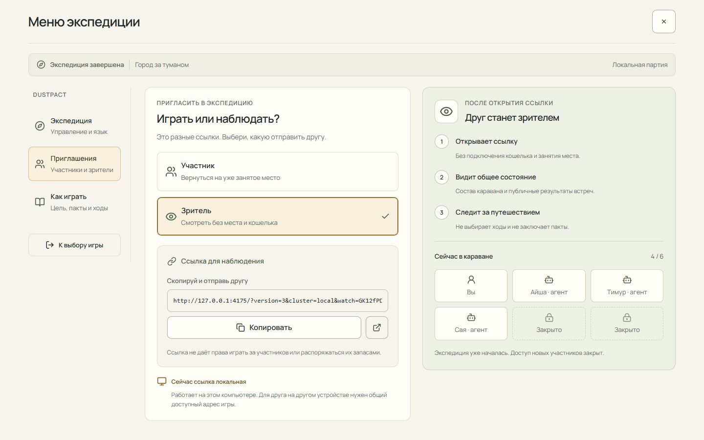

**Играть онлайн:** [DUSTPACT](https://dimik98330.github.io/DUSTPACT/) — бесплатная 3D-экспедиция в режиме обучения, без кошелька. Сетевые матчи, договоры в Solana и эскроу требуют отдельного запуска Solana и сервисов, описанного ниже.

<p align="center">
  
</p>

<p align="center">
  <strong>Социальная 3D-стратегия, в которой пакт превращает обещание в проверяемое обязательство.</strong>
</p>

<p align="center">
  <a href="README.md">English</a> · <a href="README.ru.md"><strong>Русский</strong></a><br>
  <a href="#быстрый-запуск">Играть локально</a> · <a href="#зачем-здесь-solana">Зачем Solana</a> · <a href="docs/DEVELOPMENT.md">Запуск всей системы</a> · <a href="docs/ARCHITECTURE.md">Архитектура</a>
</p>

<p align="center">
  
  
  
  
</p>

---

## Один караван. Разные интересы.

Участники начинают с разными запасами воды и инструментов; **груза нет ни у кого**. Четырём–шести путникам нужно вместе добраться до города. По дороге вы восстанавливаете колодец, договариваетесь о ремонте моста, вкладываетесь в добычу и защищаете заработанное.

Всем нужно общее прибытие. Каждый при этом хочет получить свой личный результат.

Можно сотрудничать на доверии. А можно принять **пакт**, который резервирует точные запасы, закрепляет действие исполнителя и заранее определяет раздел результата. Партнёр может отключиться — принятое обязательство продолжит действовать по правилам программы.

<p align="center">
  
  <sub>Реальный интерфейс игры. Учебный режим использует те же правила Rust/Wasm без блокчейна.</sub>
</p>

## Быстрый запуск

Нужны **Node.js 22.12+ и npm**. Браузерное ядро уже включено: для обучения не требуются кошелёк, Rust, база данных или SOL.

```bash
git clone https://github.com/dimik98330/DUSTPACT.git
cd DUSTPACT
npm ci
npm run demo
```

Открой **[учебную экспедицию](http://127.0.0.1:4173/?version=3&mode=practice&tutorial=0&lang=ru)**. Выбирай действия, договаривайся с тремя явно обозначенными игровыми агентами и пройди шесть встреч.

| Режим               | Что работает                                                                  | Что потребуется                                                           |
| :------------------ | :---------------------------------------------------------------------------- | :------------------------------------------------------------------------ |
| **Обучение**        | Настоящая 3D-игра и локальный расчёт Rust/Wasm                                | Node.js, без кошелька                                                     |
| **Solana Localnet** | Игровая программа, токеновый vault, подписи и сессии, комнаты, восстановление | Solana-инструменты и локальные сервисы; [инструкция](docs/DEVELOPMENT.md) |

> Обучение явно обозначено как **offchain**: транзакций Solana и выплат токенов в нём нет. Localnet использует симулированные тестовые токены без денежной стоимости, не выпущенные Circle.

## Шесть встреч — шесть разных решений

| Встреча                  | Решение                                          | Зачем договариваться                                               |
| :----------------------- | :----------------------------------------------- | :----------------------------------------------------------------- |
| **Разрушенный колодец**  | Вложиться в воду или выбрать сухой обход         | Твои запасы, инструмент и действие партнёра закрывают рецепт       |
| **Сломанный мост**       | Совместный ремонт или обход за воду              | Купить конкретный ремонтный вклад; путь влияет на следующую добычу |
| **Заброшенная кладовая** | Потратить входные ресурсы на ограниченную добычу | Заранее определить исполнителя и раздел груза                      |
| **Засада**               | Защищать общее или готовить личный план          | Закрепить чужое действие охраны                                    |
| **Пыльная буря**         | Подготовить укрытие и пополнить запасы           | Прежние потери меняют цену нужной работы                           |
| **Город за туманом**     | **Доставка, охрана или рынок** — одно действие   | Пакт доставки закрепляет уже имеющийся груз и действие партнёра    |

На встречу у игрока одно действие и одна печать пакта. Пакт гарантирует формальный вклад, **а не победу каравана**. Свободные планы скрыты до раскрытия.

Личный счёт: **3 × оставшийся груз + доставленный груз + вклад**. Чтобы сохранить эти очки, караван должен прибыть, а игрок — не потерять личный зачёт.

## Зачем здесь Solana

В цепочке обязательство становится исполняемым правилом игры.

| Ответственность программы          | Что получает игрок                                                                   |
| :--------------------------------- | :----------------------------------------------------------------------------------- |
| **Точное согласие**                | Подпись одобряет конкретные условия                                                  |
| **Резерв запасов**                 | Принятые входы нельзя потратить на другое действие                                   |
| **Закреплённая работа и доставка** | Обязательство сохраняется при пропуске раскрытия по правилам игры                    |
| **Канонический расчёт**            | Программа исполняет действия, доставку и сохраняет результат                         |
| **Независимое восстановление**     | Другой клиент завершает исполнение напрямую через RPC без нашего прикладного сервера |
| **Отдельный тестовый escrow**      | У выполненного задания фиксированный получатель; повторной выплаты нет               |

**Виды пактов:** мгновенный обмен, заказ работы, совместное производство и городской пакт доставки. Координаты персонажа, анимации, чат и проекции бэкенда не определяют результат.

Восстановлению нужен доступный Solana RPC. Чтобы раскрыть свой commitment, необходима исходная сохранённая копия хода: независимый клиент не восстанавливает неизвестный скрытый выбор.

<p align="center">
  
</p>

### Необязательная миссия: два оплачиваемых ремонта

Заказчик отдельно вносит **20 тестовых токенов**. Два ремонта оплачиваются **по 10**. Вход в игру бесплатный, денежных ставок нет. Получатель закреплён владельцем места исполнителя; выполненная работа сохраняет право выплаты даже после общего провала.

Незанятые задания возвращаются после срока. Принятые средства ждут результата программы. Демонстрационные агенты исключены из оплачиваемых заданий. Ограниченная игровая сессия не может списывать токены кошелька владельца.

## Архитектура, которую можно проверить



| Слой                          | Исходники                                                                                  |
| :---------------------------- | :----------------------------------------------------------------------------------------- |
| Игра и 3D-мир                 | [`apps/web`](apps/web)                                                                     |
| Независимый клиент            | [`apps/recovery`](apps/recovery)                                                           |
| Общие правила Rust/Wasm       | [`crates/rules-v3`](crates/rules-v3), [`crates/rules-v2`](crates/rules-v2)                 |
| Игровая программа и vault     | [`programs/game-v3`](programs/game-v3), [`programs/pact-vault-v3`](programs/pact-vault-v3) |
| Транзакции и проверка истории | [`packages/solana-v3`](packages/solana-v3), [`packages/engine`](packages/engine)           |
| Прикладные сервисы            | [`services/backend`](services/backend)                                                     |

Текущая игра использует протокол 3. Модули протокола 2 остаются явными зависимостями совместимости; скрытой миграции матчей нет.

## Проверки

```bash
npm run typecheck
npm run backend:typecheck
npm test
npm run build
```

Пересборка браузерных правил из Rust: `npm run build:wasm`. Сборка программ Solana и запуск сервисов описаны в [DEVELOPMENT.md](docs/DEVELOPMENT.md).

## Что подтверждено и что ещё проверяется

**Локальные доказательства:** проверены нативные программы и общие правила; через SDK завершена кампания из шести встреч; принятая доставка исполнилась при пропущенном раскрытии исполнителя; независимый клиент завершил расчёт при выключенных прикладных сервисах. В отдельном escrow-сценарии выплачено 10 тестовых токенов, возвращены оставшиеся 10; повторные вызовы не повторили эффект. Это проверки с сгенерированными тестовыми участниками, не с внешними кошельками или новыми людьми.

**Ещё предстоит подтвердить:** два внешних Wallet Standard кошелька, непрерывный многопользовательский браузерный путь, понимание и удержание игроков, проверенное публичное развёртывание. Репозиторий содержит локальный MVP для хакатона. Публичное развёртывание в mainnet/devnet и неизменяемость публичных программ не заявляются.

<details>
<summary><strong>Ещё интерфейс игры</strong></summary>







</details>

---

**Права на код.** Исходники публично доступны для просмотра; общая open-source лицензия проекту не предоставлена. У сторонних ассетов сохраняются исходные лицензии. [Авторы и лицензии ассетов](docs/ASSETS.md).
