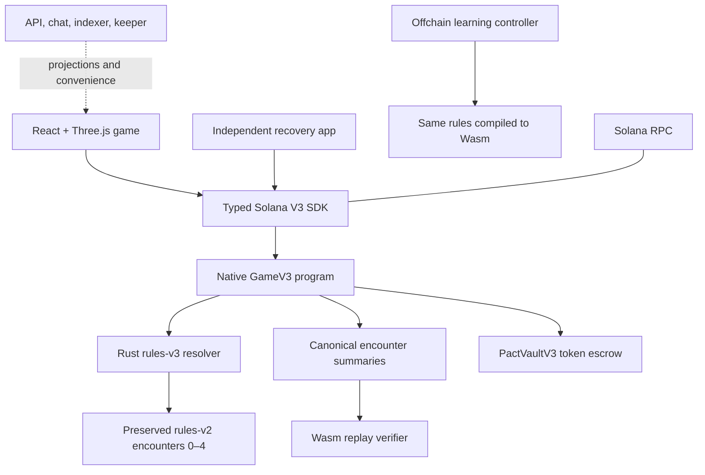

# DUSTPACT architecture

[Run locally](DEVELOPMENT.md) · [English README](../README.md) · [Русский README](../README.ru.md)

DUSTPACT separates the 3D presentation from the authority that resolves a game. Protocol 3 is the current product protocol. The shared protocol 2 resolver and explicitly scoped compatibility modules remain dependencies; they do not represent a second supported game edition, and existing accounts are never silently migrated.

## Authority and data flow

The native game program owns match state, actor authorization, phase changes, pact reservations and settlement. The vault owns the separate token mission. The API and 3D coordinates cannot authorize a pact, allocate a reward or change the canonical result.

## One encounter

1. **Plan and negotiate.** Players have one action and one pact seal. A proposal states exact parties, inputs, output split or price, encounter context and nonce.
2. **Accept and reserve.** Accepted terms reserve resources, consume the required seals and bind the provider's formal action. Acceptance clears readiness so players review the changed context. Accepted pacts cannot be cancelled.
3. **Commit.** The client saves the private move and salt before submitting the move commitment. Unbound choices remain hidden.
4. **Reveal.** The original move preimage is checked against its commitment and the current authorized context. Voluntary delivery reserves free pre-settlement cargo.
5. **Resolve.** The Rust resolver computes the canonical outcome; the program retains the encounter summary. Saved state makes repeated resolution idempotent.

Deadlines and phase conditions permit progress without every participant staying online. Missing reveal forfeits that player's personal score and defaults their free choices; already accepted work, pledged delivery and prices remain governed by the accepted terms. A pact guarantees a contribution, not the caravan's arrival.

## Final encounter and DeliveryPledge

The city offers **Deliver, Guard or Market**, with one action per seat. A DeliveryPledge reserves **1–5 cargo already owned** by the provider and binds Deliver; the other party pays a nonzero resource bundle. Incoming payment or newly produced Market cargo cannot finance that same encounter's pledged/voluntary delivery.

The provider may add voluntary delivery only within the total five-cargo cap and available free cargo. Receipts retain pledged quantity, voluntary quantity and prices separately. Normal arrival requires delivery equal to party size; the emergency route requires sufficient delivery, distinct guards and positive hull under the resolver's threat rules.

Personal score on arrival is `3 × remaining cargo + delivered cargo + contribution`, for seats that retain their personal record. The rules do not reward an unarrived caravan as a tie of winners.

## Separate token mission

PactVaultV3 holds an optional sponsor-funded mission with two ten-token bridge-repair jobs. Entry needs no stake. The vault pins the game program, mint and Token Program; it relies on canonical game outcomes, not an API claim. The provider's seat owner is the fixed payout recipient. Demonstration agents cannot take paid slots, and a bounded game session cannot debit the owner's wallet tokens.

Unaccepted slots can refund after their deadline. Accepted slots wait for the relevant result. Completed work keeps its payout right even if the caravan later fails. Payment/refund retries cannot repeat the effect. Localnet uses valueless test tokens; no Circle-issued USDC or real-fund support is claimed by the local fixture.

## Identity, sessions and signing

Owner signatures approve exact configuration or pact terms. An optional game session has limited authority, expiry and quota. Revocation and exhaustion require renewed authorization. Public-network signing also requires a reviewed release policy that pins the relevant program identity and release properties; pointing at a different RPC is insufficient.

The backend verifies wallet signatures, scoped nonces, sessions and origins. Mutations retain CSRF validation and request/storage/rate bounds. Local service signing and fee sponsorship are opt-in and disabled by default. Signing keys and generated runtime identities are local state, not repository contents.

## Recovery and transaction uncertainty

The recovery app communicates directly with Solana RPC. It can inspect retained state, verify encounter history through Wasm and submit authorized/permissionless operations without the API, chat, indexer or keeper. This independence still requires a reachable RPC and a valid signer for transactions.

Hidden choices are not recoverable from a commitment hash. Revealing requires the exact saved move and salt. The main client exports a private recovery bundle with move context and public send history; another browser origin must import it explicitly. The bundle grants no signing authority and cannot restore a lost wallet/session key.

The SDK retains transaction sends and reconciles unknown transport outcomes before fresh signing. Stale observations, mismatched context or unresolved sends block unsafe retries. A backup may predate a later send; recovery respects the blockhash uncertainty window instead of assuming that no transaction occurred.

## Source map

| Location                                              | Responsibility                                                                         |
| ----------------------------------------------------- | -------------------------------------------------------------------------------------- |
| [`apps/web`](../apps/web)                             | Game entry, 3D world, camera, HUD, pact UI, practice and online controllers            |
| [`apps/recovery`](../apps/recovery)                   | Independent chain reader, private-copy import, replay and recovery actions             |
| [`crates/rules-v3`](../crates/rules-v3)               | Current resolver and final-encounter extension, compiled to Wasm and SBF               |
| [`crates/rules-v2`](../crates/rules-v2)               | Shared earlier-encounter rules preserved as a dependency                               |
| [`programs/game-v3`](../programs/game-v3)             | Native match authority and instruction validation                                      |
| [`programs/pact-vault-v3`](../programs/pact-vault-v3) | Separate two-slot token escrow                                                         |
| [`packages/solana-v3`](../packages/solana-v3)         | Typed instructions/readers, exact consent, release policy, pending-send reconciliation |
| [`packages/engine`](../packages/engine)               | Wasm loading, learning agents and encounter replay                                     |
| [`packages/ui`](../packages/ui)                       | Shared language and local identity helpers                                             |
| [`services/backend`](../services/backend)             | PostgreSQL API, rooms/chat, projections, keeper and optional fee service               |
| [`tests`](../tests)                                   | Rules, SDK, recovery and integration regression checks                                 |
| [`scripts`](../scripts)                               | Portable local helpers, builds and reviewed artifact verification                      |

Local native evidence uses generated actors. External wallets, public release verification and player research remain separate acceptance work; neither a passing unit test nor this diagram proves them.
